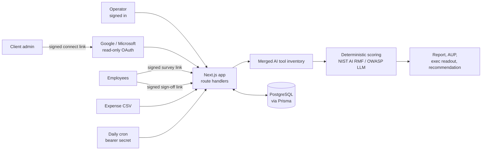
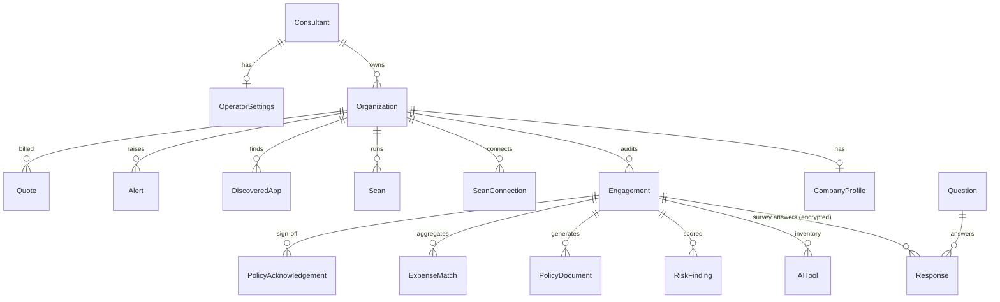

# Shadowline

A web app for running "shadow AI" audits at small and mid-sized businesses: finding the AI tools staff use without approval, scoring the data-leakage risk, and producing the policy and paper trail to fix it.

Built by Ramiz Ghareeba. Status: working prototype, run locally. Not deployed, no real client data has ever been in it.

## The security problem

Staff paste customer records, contracts, source code and patient notes into ChatGPT, Claude, Gemini and browser extensions on personal accounts. The company has no inventory of which tools are in use, no contract covering the data, no way to delete it later, and usually no written policy. That is "shadow AI": the same problem as shadow IT, with a faster path for data to leave the building.

Most small businesses have no security team to find this. Shadowline is the tool one operator (a consultant or IT person) uses to audit a company from the outside, using three independent sources of evidence instead of trusting one.

## How an audit works

1. **Company profile.** A short questionnaire with the owner: industry, headcount, office suite, sensitive data types, tools already provided.
2. **Workspace scan.** The client's admin opens a signed connect link and grants read-only access to Google Workspace (Admin SDK, OAuth) or Microsoft 365 (Entra admin consent). The app lists third-party apps with access to work accounts, classifies which ones are AI tools against a catalog, and records scopes and user counts. A demo connector covers the same flow without a real tenant.
3. **Expense scan.** The operator uploads a card or expense CSV. Merchants are matched against an AI vendor catalog and only the aggregates are stored (vendor, charge count, totals, date range). The raw file is never saved.
4. **Anonymous employee survey.** 13 plain-English questions about which tools people use, on what kind of account, with what data. One random respondent id per submission, answers encrypted at rest, free-text comments withheld until at least 5 people respond.
5. **Inventory.** The three evidence sources merge into one AI tool inventory, with the source of each row tracked. Operator edits are preserved when the inventory is rebuilt.
6. **Scoring.** Deterministic: likelihood x impact (1 to 5 each), banded red / amber / green. Each finding maps to a NIST AI RMF 1.0 function and OWASP Top 10 for LLM Applications 2025 categories. No LLM is involved in scoring.
7. **Recommendation.** A rules-based ranking of team AI plans (ChatGPT Business, Claude Team, Microsoft 365 Copilot, Gemini in Workspace) based on the company's suite, compliance needs, cost and admin controls. Vendor prices carry a "checked on" date and source URL.
8. **Documents.** Risk report, Acceptable Use Policy (13 required sections), one-page executive readout, platform recommendation. Markdown source, rendered to HTML that escapes all user-entered text, printable to PDF.
9. **Policy sign-off.** Employees sign the published policy through personal links; the operator sees who has signed, who is pending and who is overdue.
10. **Monitoring.** A daily cron job re-runs scans, raises alerts for new AI apps and new users, and schedules a quarterly re-survey.



## Security controls in the code

These are implemented and covered by unit tests or the end-to-end script. File paths point to where each control lives.

| Control | How | Where |
|---|---|---|
| Tenant isolation | Every authenticated query is filtered by the signed-in operator's id. A record owned by someone else returns 404, the same as one that does not exist, so ids cannot be probed. | `src/lib/ownership.ts`, `src/lib/api-auth.ts` |
| Input validation | Every route body and query is parsed with zod schemas before use. Prisma parameterizes all queries. | `src/lib/validation.ts`, `src/lib/*-validation.ts` |
| Signed, purpose-bound links | HS256 tokens carry a `purpose` claim (survey, connect, sign-off, magic link, OAuth state), so a token minted for one flow is rejected by every other. Short expiries where the link grants write access. | `src/lib/tokens.ts` |
| Single-use tokens | Magic links and OAuth state carry a `jti` recorded on first use; replay fails on a primary-key conflict. | `src/lib/token-store.ts` |
| Encryption at rest | AES-256-GCM for survey answers, connector refresh tokens / tenant ids, and scanned user lists. Credentials are never returned to the browser. | `src/lib/crypto.ts`, `prisma/schema.prisma` |
| Authentication | Auth.js v5, bcrypt (cost 12) passwords, emailed magic links that are never logged. Login does a dummy bcrypt compare for unknown emails to avoid account enumeration by timing. | `src/lib/auth.ts` |
| Closed registration | After the first account exists, sign-up requires an invite code. | `src/app/api/auth/register/route.ts` |
| Rate limiting | Login (per IP and per account), registration, magic links, survey, sign-off, connect, CSV upload and AI drafting. | `src/lib/rate-limit.ts` |
| OAuth hardening | State is signed, short-lived, single-use and bound to a browser nonce cookie. Redirect URIs are fixed server-side, never taken from the Host header in production. The connected domain is cross-checked against the company. | `src/lib/connectors/oauth-state.ts`, `src/lib/ownership.ts` |
| Upload limits | CSV capped at 2 MB, 20,000 rows and 2,000 characters per cell, parsed server-side only. | `src/lib/expenses/csv.ts` |
| Webhook and cron auth | Stripe webhook verifies the signature and checks `payment_status` and amount. Cron requires a bearer secret compared in constant time. | `src/app/api/stripe/webhook/route.ts`, `src/app/api/cron/monitor/route.ts` |
| Output escaping | The Markdown to HTML renderer escapes everything by construction (tested with a `<script>` payload). | `src/lib/documents/markdown.ts` |
| Security headers | CSP (no external scripts, no framing, no object embeds), X-Frame-Options DENY, nosniff, Referrer-Policy, Permissions-Policy, HSTS in production. | `next.config.ts` |
| Secrets | None in the repo. `.env.example` documents every variable. Missing or wrong-length secrets throw a clear error instead of falling back to a default. | `.env.example` |

Two code-level security review passes were run against the app. The first found 2 high and 6 medium issues (including magic links being logged instead of emailed and no login rate limit); all high and medium items were fixed. The second found no critical or high issues and 3 medium ones, which were fixed. Details in [docs/security-review.md](docs/security-review.md).

### Known gaps (not yet fixed)

- The rate limiter is in-memory, so on serverless hosting each instance counts separately. It needs a shared store (Redis or similar) before production.
- The CSP allows `'unsafe-inline'` for scripts and styles because Next.js needs it without nonce middleware. A nonce-based CSP is the next hardening step.
- The Google and Microsoft connectors are implemented against the documented APIs but have not been run against a live tenant (that needs registered OAuth apps). The demo connector exercises the full flow.
- Stripe checkout and the webhook need real keys to run; without them, quotes are marked paid by hand.

## Data model

PostgreSQL through Prisma 7. Full schema in [prisma/schema.prisma](prisma/schema.prisma), summary in [docs/architecture.md](docs/architecture.md).



`Consultant` is the operator, `Organization` is the client company and `Engagement` is one audit. Ownership flows down from `Consultant`, which is what the tenant check filters on.

## Stack

Next.js 16 (App Router, route handlers), TypeScript, React 19, Tailwind CSS 4, shadcn/ui (Base UI), Prisma 7 with PostgreSQL 16, Auth.js v5, zod, jose, bcryptjs, Stripe, Vitest. Optional: Resend for email, Anthropic SDK for an opt-in "draft this recommendation" button that is clearly labeled in the UI and never touches scoring.

A separate marketing site lives in `landing/` (Next.js, contact form only, no prices).

## Run it locally

```bash
npm install
docker compose up -d              # Postgres 16 on port 5433
cp .env.example .env.local        # fill AUTH_SECRET, TOKEN_SECRET, FIELD_ENCRYPTION_KEY
                                  # (openssl rand -base64 32 for each)
npx prisma migrate deploy
npx prisma db seed                # loads the survey and IT question banks
npm run dev                       # http://localhost:3000
```

Register the first account at `/register`. Without email configured, magic links print to the server console in development. Google, Microsoft, Stripe, email and AI drafting are all optional; the Settings page shows which are configured.

| Command | What it does |
|---|---|
| `npm test` | Vitest unit tests (131 tests: scoring, tokens, encryption, CSV parsing, classification, recommendation, documents, pricing) |
| `npm run lint` | ESLint |
| `npm run build` | Production build |
| `npm run e2e` | End-to-end script against a local dev server: register, create company, scan, survey, findings, documents, sign-off, plus cross-tenant and impersonation checks. Refuses to run against non-local hosts. |

## Skills demonstrated

**Security**
- Threat-modeling a real risk (data leaving through unsanctioned AI tools) and mapping findings to NIST AI RMF 1.0 and OWASP Top 10 for LLM Applications 2025.
- Implementing access control, encryption at rest, signed single-use tokens, rate limiting, OAuth state binding and security headers, then running review passes and fixing what they found.
- Being explicit about residual risk (the known gaps above) instead of claiming it is done.

**Business systems analysis**
- Turning a consulting process into a 12-stage workflow with a data model behind it.
- Writing requirements for an operator, a client admin and employees who never log in, each with a different level of access.
- Deterministic, explainable scoring and a rules-based vendor comparison that a non-technical owner can follow.

**IT support and administration**
- Working with Google Workspace Admin SDK and Microsoft Entra (app registrations, admin consent, read-only directory and app-grant scopes).
- Local environment setup with Docker Postgres, environment variables, migrations and seed data.
- Writing end-user facing material: a plain-English survey, an acceptable use policy template, setup steps.

## License

MIT, see [LICENSE](LICENSE).
